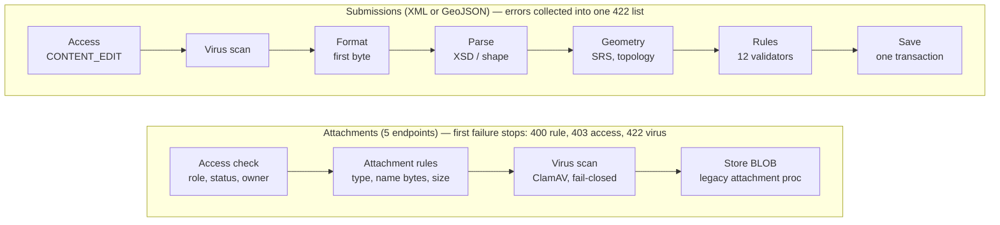

# File Uploads & Validation

How FSP accepts uploaded files and exactly what it validates, front to back.
Companion docs: [submissions.md](submissions.md) (submission pipeline),
[submission-geojson-spec.md](submission-geojson-spec.md) (GeoJSON contract),
[virus-scanning.md](virus-scanning.md) (ClamAV setup).

> **Scope:** the regular FSP attachment upload (`POST /{fspId}/attachments`,
> the Attachments tab) is not covered here.

## Overview

FSP accepts files through seven multipart endpoints, all under `/api/v1/fsp`. Every one virus-scans the bytes before anything is stored. The five attachment endpoints also run the shared attachment rules (type, filename length, size); the two submission endpoints do not (see [Gaps](#gaps-and-recommendations)).

There are two kinds of upload:

- **Attachments**: PDF/Word documents stored as Oracle BLOBs, linked to an FSP version, an extension, or a stocking-standards regime.
- **Submissions**: one XML or GeoJSON file describing a whole plan (header, FDUs with geometry, stocking standards), plus optional attachments. It is parsed, checked by 13 validators, previewed, then saved in one transaction.

| Endpoint | What it uploads | Role gate | Shared attachment rules | Virus scan | Stored via |
| --- | --- | --- | --- | --- | --- |
| `POST /{fspId}/workflow/ddm-decision` | DDM decision letter (`DDMD`) | `WORKFLOW_DECISION` + `assertAttachmentEditable` | Yes (via `AttachmentsService.upload`) | Yes | `FSP_400_ATTACHMENTS.CREATE_ATTACHMENT` + `SAVE_ATTACHMENT_CONTENT` |
| `POST /{fspId}/extensions/submit` | Extension request + supporting docs (one transaction) | `CONTENT_EDIT` + `assertAttachmentEditable` | Yes, per file | Yes, per file | `FSP_302_EXTENSION_REQUEST.CREATE_ATTACHMENT` |
| `POST /{fspId}/extensions/{extensionId}/attachments` | Extension-linked file | `WORKFLOW_DECISION` + `assertAttachmentEditable` | Yes | Yes | same as above |
| `POST /{fspId}/extensions/{extensionId}/decision` | Extension decision letter (`EXDDMD`) | `WORKFLOW_DECISION` + `assertAttachmentEditable` | Yes (via `ExtensionService.uploadAttachment`) | Yes | same as above |
| `POST /{fspId}/standards/{regimeId}/attachments` | Stocking-standard supporting doc | `CONTENT_EDIT` + `assertContentEditable` + `assertStandardsRegimeEditable` | Yes | Yes | `FSP_550_STDS_PROPOSAL.ADD_ATTACHMENT` + `SAVE_ATTACHMENT` |
| `POST /submissions/validate` | Submission file, dry run | `CONTENT_EDIT` | No (not an attachment) | Yes | nothing (validate only) |
| `POST /submissions` | Submission file + optional `attachments` parts | `CONTENT_EDIT` | **No** | Yes | `SubmissionPersistenceService` (one transaction) |

All file bytes are read fully into JVM heap (`MultipartFile.getBytes()`); nothing is streamed to disk by the app.

Attachments stop at the first failed gate; submissions collect every parse, geometry and rule error into one list. `/submissions/validate` stops before Save.

## Frontend validation

The SPA rejects bad files at pick time, before any request is sent. These checks are for user experience only; the backend repeats every one that matters (except where [Gaps](#gaps-and-recommendations) says otherwise).

### Attachment rules (shared)

Defined once in `frontend/src/lib/attachmentConstraints.ts` and kept in lockstep with the backend `AttachmentConstraints`. `validateAttachmentFile(file)` checks in this order and returns the first failure as a toast:

1. **Extension allow-list**: the name, lower-cased, must end with `.pdf`, `.doc` or `.docx`. This is a name check only; file contents and the browser-reported MIME type are not inspected.
2. **Filename length**: at most **50 UTF-8 bytes**, extension included. Bytes, not characters, because `ATTACHMENT_NAME` is `VARCHAR2(50)` with byte semantics. An en-dash costs 3 bytes and an accented letter 2, so a 49-character name can fail. The message mentions multi-byte characters only when they caused the failure.
3. **Size**: at most **50 MB** (52,428,800 bytes).

The `accept` attribute on `DragDropFileInput` passes the same allow-list to the OS file picker. It is only a hint: drag-and-drop bypasses it, which is why `validateAttachmentFile` runs on every pick.

### Per-screen rules

| Screen | File | Rules applied | Extra rules |
| --- | --- | --- | --- |
| Standards regime attachment (`StandardRegimeAttachmentModal`) | Stocking-standard doc | Own `fileProblem()`: extension, then size, then filename bytes (same limits, different order) | File required; description required |
| Extension request (`ExtensionRequestModal`) | Supporting docs | `validateAttachmentFile` per file | Max **4 files**; a duplicate (same name and size) is silently skipped |
| Extension decision (`ExtensionDecisionEditModal`) | `EXDDMD` letter | `validateAttachmentFile` | Letter **required** when recording a first decision |
| DDM decision (`DdmDecisionEditModal`) | `DDMD` letter | `validateAttachmentFile` | Letter **optional** in the dialog; the DDM save proc decides if one must exist |
| Data submission (`XmlSubmissionPage.tsx`) | XML / GeoJSON | Own `validateFile()`: rejects an empty (0-byte) file, then a file over **50 MB** | Picker hint `.xml,.json,.geojson`; **no** extension check on drop. The page sends no attachments. |

After a file passes, the submission page auto-calls `POST /submissions/validate` and renders the returned issues in a table.

## Backend validation

The backend is the enforcement point. Each attachment upload runs four gates in a fixed order, and the first failure stops the request before any database write.

### 1. Transport limits (Spring / servlet container)

Set in `backend/src/main/resources/application.properties`. Breaching them returns Spring's default `ProblemDetail` (`MaxUploadSizeExceededException`, handled by the parent `ResponseEntityExceptionHandler`).

| Setting | Value | Effect |
| --- | --- | --- |
| `spring.servlet.multipart.max-file-size` | 100 MB | Any single part over this is refused before our code runs |
| `spring.servlet.multipart.max-request-size` | 500 MB | Whole multipart request cap |
| `server.undertow.max-http-post-size` | 524,288,000 bytes (500 MB) | Matches the request cap |
| `server.tomcat.max-http-form-post-size` / `max-swallow-size` | 524,288,000 bytes | Same, if run on Tomcat |

The 100 MB part cap is deliberately looser than the 50 MB attachment rule, so an oversized attachment gets our friendly message rather than a container error.

### 2. Access checks (before reading the file)

| Path | Checks |
| --- | --- |
| DDM decision letter | `@PreAuthorize(WORKFLOW_DECISION)`, then `FspAccessGuard.assertAttachmentEditable(fspId, null, typeCode)`: Administrator any status; Submitter Draft only; Decision Maker on SUB/OHS; Reviewer on SUB. Also fences BCeID users to their own client's FSPs. |
| Extension supporting docs / attachment / decision letter | Same `assertAttachmentEditable`, with typeCode threaded so the carve-outs apply: a Submitter may add `OTHR` while an extension is open on an APP/INE plan, and a Decision Maker may add `EXDDMD` on an APP/INE plan |
| Standards regime attachment | `@PreAuthorize(CONTENT_EDIT)`, `assertContentEditable(fspId, amendmentNumber)`, `assertStandardsRegimeEditable(regimeId)`. Regime must exist (else 400 "Standards regime … not found") |
| Submissions | `@PreAuthorize(CONTENT_EDIT)` (Administrator / Submitter) |

Access failures return 403.

### 3. Attachment rules (`util/AttachmentConstraints.validate`)

Called by `AttachmentsService.upload` (DDM letter), `ExtensionService.uploadAttachment` (all extension files) and `StandardRegimeService.addAttachment`. Same order and limits as the frontend. Each failure throws `IllegalArgumentException`, returned as **400** with the message as written below.

| # | Rule | Exact check | Message |
| --- | --- | --- | --- |
| 1 | Extension | `name.toLowerCase(Locale.ROOT)` ends with `.pdf`, `.doc` or `.docx`. A null name is treated as empty and fails. | "File type not supported. Upload a .pdf, .doc, or .docx file." |
| 2 | Filename length | `name.getBytes(UTF_8).length <= 50` | "File name too long. Use 50 characters or fewer, including the extension…" plus the character and byte counts |
| 3 | Size | `MultipartFile.getSize() <= 52,428,800` | "File exceeds size limit. Max file size is 50 MB. Select a smaller file and try again." |

What is **not** checked: file contents or magic bytes (a renamed `.exe` called `x.pdf` passes rule 1), the client-sent `Content-Type`, a zero-byte file, and path characters in the name. The name is stored as the client sent it.

### 4. Business rules on attachments

- **DDM letter target version** is always the FSP's highest `fsp_amendment_number`; the client cannot choose it. No amendments returns 400. The letter is stored with consolidated indicator `N`.
- **Extension request + files** (`/extensions/submit`) run in one transaction: any file failing any rule rolls back the extension too. Empty file parts are skipped silently.
- **Decision letters and decisions** are one unit of work: the letter is saved first (the workflow procs check that it exists), and a failed decision rolls the letter back.

### 5. Virus scan (`service/v1/VirusScanner`)

Every path scans the full byte array with ClamAV `clamd` (TCP `INSTREAM`, 8 KB chunks) after the rules above and before the first database write. Details are in [virus-scanning.md](virus-scanning.md).

| clamd result | Fail-closed (`CLAMAV_FAIL_OPEN=false`, default) | Fail-open (`true`, local/PR only) |
| --- | --- | --- |
| `OK` | Accept | Accept |
| `<sig> FOUND` | Reject: **422** `VIRUS_DETECTED`, "Upload rejected: a virus was detected (&lt;signature&gt;)." | Reject (always) |
| Error, timeout (connect 5 s, read 30 s), empty reply, unreachable | Reject: **422** `VIRUS_SCAN_UNAVAILABLE`, "…the virus scanner could not verify this file. Try again shortly." | Accept unscanned, logged at WARN |
| `CLAMAV_ENABLED=false` | Not scanned | Not scanned |

The filename is stripped of control characters before it is logged, so a CR/LF in a name cannot forge log lines.

## Submission file: parsing and geometry

A submission file goes through scan, format detection, parse and geometry checks before any business rule runs. Every failure becomes a `SubmissionValidationError {path, code, message}`. Errors are collected, not thrown, so one response lists them all (HTTP **422**). The exceptions are virus, format and envelope failures, which stop the pipeline at that step.

### Request checks (`FspSubmissionController`)

- The `file` part must be present and non-empty, or **400** `UPLOAD_MISSING`.
- The submission file has **no** app-level size cap; only the 100 MB multipart limit applies (the SPA caps it at 50 MB).
- On `POST /submissions`, each `attachments` part is virus-scanned **before** the main file is validated. Empty parts are skipped.

### Pipeline (`SubmissionValidationService.validateAndParse`)

1. **Virus scan** of the raw bytes. A rejection returns `VIRUS_DETECTED` or `VIRUS_SCAN_UNAVAILABLE` and stops.
2. **Format detection** (`detectFormat`): skip a UTF-8 BOM (`EF BB BF`) and spaces, tabs, CR, LF. The first remaining byte decides: `<` means XML, `{` means GeoJSON. Anything else, or an empty file, is `FORMAT_UNRECOGNIZED` and stops. The filename extension is ignored.
3. **Parse**: XML or GeoJSON, below. Both produce the same JAXB tree (`FSPSubmissionType`), so later steps are shared.
4. **Geometry**, then **business rules** (next section). Both run only if parsing produced a tree.
5. **Preview** is built even when there are errors, so the user sees what was read.

### XML path

| Step | Rule | Error code |
| --- | --- | --- |
| Root detection (`SubmissionEnvelopeStripper`) | Root must be `{http://www.for.gov.bc.ca/schema/fsp}fspSubmission` or the legacy ESF wrapper `{http://www.for.gov.bc.ca/schema/esf}ESFSubmission` | `ENVELOPE_PARSE_ERROR`, `ENVELOPE_UNRECOGNIZED` |
| ESF unwrap | ESF root must contain `<esf:submissionContent>`, whose child must be `<fsp:fspSubmission>` | `ENVELOPE_MISSING_CONTENT`, `ENVELOPE_NOT_FSP`, `ENVELOPE_EXTRACTION_FAILED` |
| XML hardening | DOCTYPE declarations refused; external general/parameter entities, external DTD loading and XInclude off; secure processing on; `ACCESS_EXTERNAL_DTD` and `ACCESS_EXTERNAL_STYLESHEET` empty. The JAXB StAX reader also has `SUPPORT_DTD=false`, `IS_SUPPORTING_EXTERNAL_ENTITIES=false` | `ENVELOPE_PARSE_ERROR` or `XML_PARSE` |
| XSD validation | JAXB unmarshals with the vendored schema `schemas/fsp/MOF/mof-fsp.xsd` (MOF + GML 2.1.2) attached. Every violation is collected with its line and column. Only the XSD 1.0 "full schema checking" pass on the schema itself is turned off, because the legacy schemas break it; instance validation is unaffected | `JAXB` (one per violation), `XML_PARSE` |

### GeoJSON path (`SubmissionGeoJsonParser`)

Contract: [submission-geojson-spec.md](submission-geojson-spec.md). Unknown JSON members are ignored.

| Rule | Error code |
| --- | --- |
| Must be valid JSON and not empty | `GEOJSON_PARSE` (stops) |
| Root `type` must be exactly `"FeatureCollection"` | `GEOJSON_UNRECOGNIZED` (stops) |
| Root must carry an `fsp` header object | `GEOJSON_MISSING_FSP` (stops) |
| `fsp.planName` non-blank | `GEOJSON_SCHEMA` |
| `fsp.actionCode` present and one of `I`, `U`, `A`, `R` (case-sensitive) | `GEOJSON_SCHEMA` |
| `fsp.planHolders` has at least one entry | `GEOJSON_SCHEMA` |
| `fsp.districts` has at least one entry | `GEOJSON_SCHEMA` |
| If `fsp.submissionMetadata` is present: `contactName` and `emailAddress` non-blank | `GEOJSON_SCHEMA` |
| `fsp.fspId`, if given, is numeric | `GEOJSON_FIELD` |
| Each feature is non-null and has `properties.fspEntityType` of `FDU` or `IDENTIFIED_AREA` | `GEOJSON_SCHEMA`, `GEOJSON_FIELD` |
| `IDENTIFIED_AREA` features are skipped (feature retired): not validated, not saved | none |
| Each `FDU` has a non-blank `properties.name` and a `geometry` with a `type` | `GEOJSON_SCHEMA` |
| Geometry type must be `Polygon` or `MultiPolygon`; coordinates and rings non-empty | `GEOMETRY_MISSING`, `GEOMETRY_UNSUPPORTED`, `GEOMETRY_PARSE_ERROR` |
| Projection comes from `crs.properties.name`. Omitting `crs` leaves the geometry without one, which fails in the next step | (see geometry) |

### Geometry (`GeometryValidator`, per FDU `extentOf`)

Runs for every FDU in order. The first failing step for an FDU records one error and skips that FDU's later steps.

1. **Present**: `extentOf` must hold a geometry, or `GEOMETRY_MISSING`.
2. **Projection read**: the `srsName` must exist and end in digits (`EPSG:3005`, `urn:ogc:def:crs:EPSG::4326`), or `GEOMETRY_PARSE_ERROR`.
3. **Projection allowed** (`SrsValidator`): after mapping legacy `42102` to `3005`, the code must be **3005** (BC Albers) or **4326** (WGS 84), or `SRS_UNSUPPORTED`.
4. **Convert** GML to JTS; a malformed ring or polygon gives `GEOMETRY_PARSE_ERROR`.
5. **Reproject** 4326 to 3005 (proj4j). Everything after this is in metres.
6. **Topology**: JTS `IsValidOp` must pass (no self-intersections, ring closure, valid holes, and so on), or `GEOMETRY_INVALID` with JTS's message.
7. **Simplify and snap** (`GeometrySimplifier`): Douglas-Peucker at **2.5 m**, snap to a **0.001 m** grid, re-check validity. If invalid, retry with topology-preserving simplification. If still invalid, `SIMPLIFY_INVALID`. The result replaces the submitted coordinates.

There is deliberately **no** check that an FDU lies inside BC (removed 2026-08-06; it rejected valid coastal plans and neither ESF nor the legacy app had one). At save time, `GeometryOrientationNormalizer` forces outer rings counter-clockwise and holes clockwise, so winding order never fails a submission. The database trigger then runs `MOF_SPATIAL_VALIDATION.VALIDATE` as a final topology check.

## Submission file: business rules

Twelve business validators run after geometry, in the order below, on every parsed submission. Each one copies a rule the legacy PL/SQL procs enforce, so the user sees a clear error at validation time instead of an ORA error or rollback at save time. Lengths are counted in characters after trimming. Action codes: `I` Initial, `U` Update, `A` Amendment, `R` Replacement.

| Validator | Applies to | Rule | Error code |
| --- | --- | --- | --- |
| `ActionCodeContextValidator` | `A`, `R` | `fspID` must be present | `FSP_ID_REQUIRED` |
|  | `A`, `R` | The FSP must have an amendment in Approved or In-Effect status | `FSP_NO_APPROVED_AMENDMENT` |
|  | `A`, `R` | The FSP must not have an open (submitted, undecided) extension request | `FSP_EXTENSION_OPEN` |
| `AmendmentApprovalRequiredValidator` | `A` | If `fduUpdateInd` or `stockingStandardUpdateInd` is true, `amendmentApprovalRequiredInd` must be true | `AMENDMENT_APPROVAL_REQUIRED` |
| `LicenceContextValidator` | all | Every FDU `licenceNumber` (trimmed, upper-cased) must exist in `PROV_FOREST_USE` | `LICENCE_NOT_FOUND` |
| `PlanTermValidator` | all | Exactly one of: a plan term (`planTermYears` and/or `planTermMonths`) or `planTermExpiry`. Both, or neither, fails | `PLAN_TERM_OR_EXPIRY_EXCLUSIVE`, `PLAN_TERM_OR_END_DATE_REQUIRED` |
| `PlanNameValidator` | `I` | `planName` required | `PLAN_NAME_REQUIRED` |
|  | all | `planName` at most **120** characters | `PLAN_NAME_TOO_LONG` |
| `AmendmentNameValidator` | all | `licenseeAmendmentName`, if given, at most **30** characters | `AMENDMENT_NAME_TOO_LONG` |
| `ContactDetailsValidator` | all | `licenseeContact` required, at most **120** characters | `CONTACT_NAME_REQUIRED`, `CONTACT_NAME_TOO_LONG` |
|  | all | `telephoneNumber` required, exactly **10 digits** (regex `\d{10}`, no spaces, dashes or brackets) | `CONTACT_PHONE_REQUIRED`, `CONTACT_PHONE_INVALID` |
|  | all | `emailAddress` required, at most **120** characters. Format is not checked | `CONTACT_EMAIL_REQUIRED`, `CONTACT_EMAIL_TOO_LONG` |
| `AgreementHolderValidator` | `I` | `planHolderList` has at least one `clientCode` | `AGREEMENT_HOLDER_REQUIRED` |
|  | all, non-admin | The submitter's own client number must be in `planHolderList` (Administrators exempt) | `SUBMITTER_NOT_AGREEMENT_HOLDER` |
|  | `A`, `R`, `U` with `fspID` | A holder already on the FSP who owns FDU licence links cannot be dropped from the list | `AGREEMENT_HOLDER_HAS_FDUS` |
|  | all | Client codes unique (trimmed, case-sensitive) and present in `FOREST_CLIENT` | `DUPLICATE_AGREEMENT_HOLDER`, `AGREEMENT_HOLDER_NOT_FOUND` |
| `DistrictCodeValidator` | `I` | At least one `districtCode` | `DISTRICT_REQUIRED` |
|  | all | Codes unique (trimmed, upper-cased) and found in the org-unit table | `DUPLICATE_DISTRICT`, `UNKNOWN_DISTRICT` |
| `FduNameValidator` | all | Each `fduName` at most **120** characters and unique within the file (trimmed, case-insensitive) | `FDU_NAME_TOO_LONG`, `DUPLICATE_FDU_NAME` |
| `StandardLayerValidator` | all | Every stocking-standard layer has a non-blank `stockingLayerCode` | `STOCKING_LAYER_CODE_REQUIRED` |
| `SpeciesCodeValidator` | all | Every layer `speciesCode` (trimmed, upper-cased) is a valid SILV tree species code. Suggests up to 5 codes that start with what was typed (`FD` gives "Did you mean FDC or FDI?") | `UNKNOWN_SPECIES_CODE` |

Identified-area content is ignored by every validator; that feature was retired.

### Save-time backstops

`POST /submissions` re-runs the whole pipeline, then saves in **one transaction**. Anything the procs or database still reject rolls the whole submission back, attachments included:

- Legacy procs (`FSP_300_INFORMATION` and others) raise `FSP.*` errors. Known codes map to curated messages in `ProcErrorMessages`.
- `FOREST_DEVELOPMENT_UNIT_GEOM` trigger runs `MOF_SPATIAL_VALIDATION.VALIDATE` (Oracle `SDO_GEOM` topology check).
- Column widths (for example `ATTACHMENT_NAME VARCHAR2(50)`) raise `ORA-12899` if anything over-long gets through.

## How failures reach the user

Attachment uploads fail with one message; submissions fail with a list. Both go through sanitising on the frontend so raw stack traces never show.

| Failure | HTTP | Body | Raised by |
| --- | --- | --- | --- |
| Part over 100 MB / request over 500 MB | 413 | Spring `ProblemDetail` | `MaxUploadSizeExceededException` (parent handler) |
| Missing `file` part on attachment endpoints | 400 | Spring `ProblemDetail` | `MissingServletRequestPartException` |
| Missing/empty `file` on submissions | 400 | `SubmissionValidationResult`, code `UPLOAD_MISSING` | `FspSubmissionController` |
| Role or ownership check | 403 | `ApiError` | `@PreAuthorize`, `FspAccessGuard` |
| Type, filename length, size; regime or FSP not found | 400 | `ApiError.message` = the curated sentence | `IllegalArgumentException` in `RestExceptionHandler` |
| Virus found or scanner unavailable (attachments) | 422 | `ApiError.message` = rejection text | `VirusDetectedException` |
| Any submission validation error, including virus | 422 | `SubmissionValidationResult {valid:false, errors[], preview}` | `SubmissionValidationService` |
| Known proc error (`FSP.*`) | 4xx | Curated text from `ProcErrorMessages` | `StoredProcedureException` handler |
| Unknown proc or database error | 500 | Generic message only | `DataAccessException` handler |

On the frontend:

- Toasts go through `NotificationProvider`, which runs `safeErrorMessage`. Any message over **240 characters**, containing a newline, or matching technical patterns ("Malformed JSON", "could not parse", and similar) is replaced with a generic fallback.
- The submission page renders `errors[]` as a table with Issue (friendly label per code, for example `VIRUS_DETECTED` as "Virus detected"), File location (`path`) and Detail. Xerces `cvc-…:` prefixes are stripped from XSD messages. The table can be downloaded as CSV.

## Gaps and recommendations

The most important gap: attachments sent with `POST /submissions` skip the shared attachment rules. The SPA never sends them, so today only a direct API client can reach it. The rest are smaller. Ordered by risk:

| # | Gap | Effect | Suggested fix |
| --- | --- | --- | --- |
| 1 | `SubmissionAttachmentService` never calls `AttachmentConstraints.validate` | Any file type is stored. A name over 50 bytes fails the insert with `ORA-12899` after validation, rolling back the whole submission as a generic 500. A mismatch with `attachmentCount` is only logged | Call `AttachmentConstraints.validate` on each part in `FspSubmissionController.submit`, before scanning |
| 2 | Type check is by extension only | A renamed executable or HTML file named `x.pdf` passes. ClamAV catches known malware only | Check magic bytes: `%PDF-` for PDF, `D0 CF 11 E0` (OLE) for `.doc`, `PK` zip with `word/document.xml` for `.docx` |
| 3 | clamd `StreamMaxLength` is not set anywhere in this repo | ClamAV's default limit is lower than our 50 MB rule (25 MB in stock `clamd.conf`). If the shared clamd uses it, larger valid files fail closed as "scanner could not verify" | Confirm the tools-namespace clamd config allows at least 100 MB |
| 4 | Zero-byte attachments are accepted | An empty PDF is stored. Only the submission page rejects empty files | Add `size > 0` to both `AttachmentConstraints` files |
| 5 | Downloads put the stored filename straight into `Content-Disposition: attachment; filename="…"` | A `"` in the name breaks the header; non-ASCII names are not RFC 5987 encoded | Build the header with Spring `ContentDisposition.attachment().filename(name, UTF_8)` |
| 6 | Submission file has no app-level size cap | A 100 MB file is held in heap several times over (bytes, DOM/JAXB tree, JTS) | Enforce 50 MB server-side to match the SPA |
| 7 | `StandardRegimeService.addAttachment` calls `file.getBytes()` twice | Holds 2× the file in heap; the DDM and extension paths were already fixed for this OOM | Read once into a local, as `AttachmentsService.upload` does |
| 8 | Standards regime stores the client-sent `Content-Type` as `mimeType` | Unverified browser value persisted | Derive from the validated extension |
| 9 | Contact email format is not checked | Only blank and over 120 characters are caught | Add a basic address check if the business wants it |
| 10 | `StandardRegimeAttachmentModal` checks size before filename; other screens check filename first | Different first error for the same bad file | Switch the modal to `validateAttachmentFile` |

Not gaps: the extension list being a hint on drag-and-drop (every pick is re-checked), and the submission page accepting any extension (the backend detects format from content).
